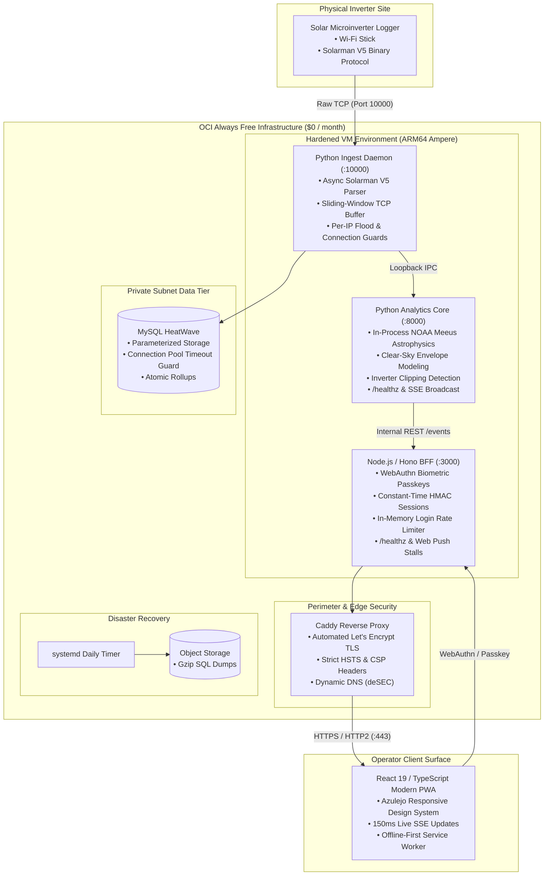

# Wattloft

[](https://github.com/uldercarrilho/wattloft/actions/workflows/ci.yml)
[](pyproject.toml)
[](plant-view/package.json)
[](plant-view/package.json)
[](.github/workflows/ci.yml)
[](docs/adr/)
[](LICENSE)

Wattloft observes production of one household solar Plant. It exists so that Plant can be watched without using the vendor cloud as the store.

Loggers push Solarman V5 frames to Wattloft on Server B. Wattloft records Samples in History. Plant view is a React app on the same hostname. Server A stays the vendor slot.

---

## Architecture Overview



---

## Key Engineering Highlights

- **Zero-Dependency Binary Protocol Ingestion**: Custom async TCP server parsing the proprietary binary Solarman V5 frame protocol using a sliding-window buffer, frame boundary extraction, and modulo-256 single-byte checksum validation without external protocol dependencies.
- **In-Process NOAA Meeus Solar Astrophysics**: Computes solar coordinates (Julian Century, Equation of Center, Sun Declination, Hour Angle, Solar Elevation/Azimuth) and Haurwitz clear-sky irradiance directly in Python, calibrating rooftop solar envelopes and detecting inverter clipping plateaus with zero external scientific libraries (`numpy`, `scipy`, `pvlib`).
- **Domain-Driven Design (DDD)**: Uncompromising adherence to a strict Ubiquitous Language documented in [`CONTEXT.md`](CONTEXT.md), supported by 33 chronological Architectural Decision Records ([`docs/adr/`](docs/adr/)).
- **Modern Web & PWA Craftsmanship**: React 19 and TypeScript 5.7 backed by a Hono BFF, featuring 150ms latency Server-Sent Events (SSE), WebAuthn biometric passkeys, constant-time HMAC credentials, and offline-first Service Workers with Web Push stall alerts.
- **Zero-Cloud-Cost Sovereignty**: Entirely hosted on the Oracle Cloud Infrastructure (OCI) Always Free tier (ARM64 Ampere VM, private MySQL HeatWave instance, Caddy reverse proxy, zero-SSH Bastion automated deployments).

---

## Plant view

On the shared hostname, the Operator sees:

- Today energy, Current Power (with as-of time), and Lifetime energy
- Local-day production bars (`America/Sao_Paulo`)
- That Local day’s Power curve (each Logger and the Plant)

A password authenticates the Operator; a passkey may as well when Vault holds `OPERATOR_PASSKEY_CREDENTIAL`. Plant view is not served over HTTP.

## Ingest

Samples arrive only from Loggers pushing on Server B (TCP, default port 10000), on the same hostname as Plant view. Wattloft does not poll.

Only Admitted Loggers may create Samples. Unknown serials get no ACK and no write. Sample time is receive time; in-frame Logger clocks are ignored.

## Runtime

Two processes on the pet VM: Python (Server B ingest, History, `GET /snapshot` on loopback) and Node (Operator session and Plant view). Caddy terminates TLS and proxies 443 to Node. History lives in private MySQL HeatWave, not on the VM.

The collector runs on an Always Free OCI pet in São Paulo. Push to `main` tests, publishes private GHCR images, and deploys through OCI Bastion. The Operator does not SSH.

## Develop

Python 3.12+ and Node 22. Tests need Docker (MySQL via testcontainers).

```bash
pip install -e ".[dev]"
pytest -q
mypy
```

```bash
cd plant-view
npm install
npm test
npm run typecheck
```

To run locally, two processes:

```bash
export DATABASE_URL=mysql://…
wattloft
```

```bash
cd plant-view
export OPERATOR_PASSWORD=…
# optional: export OPERATOR_PASSKEY_CREDENTIAL='{"credentialId":"…","publicKey":"…","rpId":"wattloft.dedyn.io"}'
export WATTLOFT_API_URL=http://127.0.0.1:8000
npm run dev
```

Open Plant view at `http://127.0.0.1:5173`. Optional Python env: `WATTLOFT_API_HOST` / `WATTLOFT_API_PORT` (default `127.0.0.1:8000`), `INGEST_HOST` / `INGEST_PORT` (default `0.0.0.0:10000`). Optional Node env: `PLANT_VIEW_HOST` / `PLANT_VIEW_PORT` (default `127.0.0.1:3000`).

## Domain

Terms live in [`CONTEXT.md`](CONTEXT.md). Decisions live in [`docs/adr/`](docs/adr/). Use that vocabulary; do not substitute synonyms the glossary avoids.
