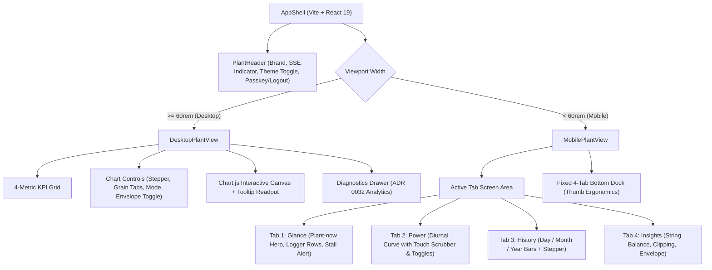

# Wattloft UI/UX Revamp Design Specification
**Topic**: Comprehensive Mobile & Web UI/UX Overhaul ("Azulejo Moderno")  
**Date**: 2026-09-24  
**Status**: Approved & Ready for Implementation  
**Target Codebase**: `plant-view` (Vite, React 19, TypeScript, Chart.js)

---

## 1. Executive Summary & Core Objectives

Wattloft is the single-household solar telemetry observer for a solar Plant composed of two microinverters (East and West strings) with local data sovereignty and direct Server B ingest.

This design specification establishes a comprehensive UI/UX overhaul across both the Web client (desktop view $\ge 60\text{rem}$) and the Mobile PWA client ($< 60\text{rem}$). The overhaul accomplishes four primary goals:
1. **Modernize the Visual System ("Azulejo Moderno")**: Evolves Wattloft's signature Portuguese ceramic tile heritage into an elevated, high-craft design language with a dual palette—Porcelain Day (light mode) and Obsidian Midnight (dark mode).
2. **Elevate Mobile Ergonomics**: Introduces a thumb-friendly 4-tab bottom navigation dock (`Glance`, `Power`, `History`, `Insights`), replacing the unergonomic horizontal snap carousel.
3. **Elevate Production Intelligence**: Surfaces passive solar diagnostics (Haurwitz clear-sky envelope, East/West array balance ratio, and inverter AC clipping from [ADR 0032](../../adr/0032-solar-diagnostics-and-production-intelligence.md)) into dedicated, prominent views without relying on third-party cloud APIs.
4. **Preserve Real-time Telemetry & Offline PWA Capabilities**: Retains zero-polling SSE updates ($\le 150\text{ms}$ latency) and offline-first caching from [ADR 0031](../../adr/0031-sse-push-and-offline-pwa.md) with smooth, flicker-free UI transitions.

---

## 2. Visual Design System: "Azulejo Moderno"

### 2.1 Color Tokens & Palette
Styling is strictly managed through CSS custom properties defined on `:root` and overridden via `[data-theme="dark"]`.

| Variable | Porcelain Day (Light) | Obsidian Midnight (Dark) | Usage & Semantics |
| :--- | :--- | :--- | :--- |
| `--paper` | `#E8EEF2` | `#0B1118` | Base viewport background |
| `--surface` | `#FFFFFF` | `#121B27` | Tile cards, chart containers, modular surfaces |
| `--surface-border` | `#D1DFEC` | `#1E2D3E` | Tile outline, dividers, table borders |
| `--surface-hover` | `#F4F7FA` | `#172333` | Interactive hover state for cards and list rows |
| `--ink` | `#1A2A3A` | `#E6EDF3` | Primary text and major numeric readouts |
| `--muted` | `#5A6B78` | `#8B9DAE` | Secondary copy, timestamps, inactive units |
| `--pigment` | `#1B4985` | `#60A5FA` | Traditional Azulejo cobalt blue; Plant total power, active states |
| `--on-pigment` | `#F4F7FA` | `#0B1118` | High-contrast text on pigment fills |
| `--logger-a` | `#2563EB` | `#38BDF8` | East microinverter curve & indicators |
| `--logger-b` | `#C4841D` | `#F59E0B` | West microinverter curve & indicators |
| `--solar-arc` | `#CBD5E1` | `#334155` | Clear-sky envelope dashed guideline |
| `--status-live` | `#10B981` | `#34D399` | SSE active connection pulse dot & nominal health |
| `--status-warn` | `#F59E0B` | `#FBBF24` | Reconnecting / midday stall alert banner |
| `--status-error` | `#EF4444` | `#F87171` | Disconnected / connection error |

### 2.2 Theme Switching & Persistence
- The active theme is controlled via `<html data-theme="light|dark">`.
- **Initialization**:
  1. Check `localStorage.getItem("wattloft-theme")`.
  2. If unset, inspect `window.matchMedia("(prefers-color-scheme: dark)").matches`.
  3. Apply corresponding attribute to `document.documentElement`.
- **Operator Toggle**: A sun/moon toggle button in the header allows instantaneous switching. When clicked, it flips the theme and saves the explicit preference to `localStorage`.

### 2.3 Typography Scale
- **Display & Header**: `Ibarra Real Nova`, serif. Font-weight: `600`, `700`. Used for "Wattloft" branding, page title, and calendar stepper headers.
- **Body & Labels**: `Source Sans 3`, sans-serif. Font-weight: `400`, `500`, `600`. Line-height: `1.4`. Used for all navigation, buttons, descriptions, and metadata.
- **Telemetry Figures & Dates**: `IBM Plex Mono`, monospace. Font-weight: `500`, `700`. Configured with `font-variant-numeric: tabular-nums;` to eliminate metric jitter during live SSE power updates.

### 2.4 Surface Geometry & Tactile Feedback
- **Border Radius**: `12px` for module cards and chart containers; `8px` for secondary items; `20px` (pill) for status badges and toggles.
- **Elevation**:
  - Light mode: `box-shadow: 0 2px 8px rgba(27, 73, 133, 0.05);`
  - Dark mode: `box-shadow: 0 4px 14px rgba(0, 0, 0, 0.35);`
- **Focus Rings**: `outline: 2px solid var(--pigment); outline-offset: 2px;` across all keyboard-focusable elements (WCAG 2.1 AA compliant).

---

## 3. Responsive Information Architecture & Navigation

The layout adheres strictly to the canonical `60rem` (`960px`) breakpoint managed by `useWideViewport`.



### 3.1 Desktop Layout ($\ge 60\text{rem}$)
- **Unified Header**: Title, real-time SSE live pulse (`● LIVE`), theme toggle (Sun/Moon), and session status (Passkey active / Log out).
- **KPI Grid**: 4 equal-width ceramic tile cards:
  1. *Current Power*: Large monospace watts, relative/absolute timestamp of most recent Sample.
  2. *Today Energy*: Daily kWh with delta vs 30-day baseline.
  3. *Lifetime Energy*: Cumulative kWh/MWh since commissioning.
  4. *Solar Envelope*: Clear-sky peak percentage with passive AC clipping status.
- **Chart Controls Bar**: Period stepper (`‹ 24 September 2026 ›`), grain tabs (`Power`, `Day`, `Month`, `Year`), drawing mode selector (`Each (Overlay)` vs `By Logger (Stack)`), and `Clear-Sky Guideline` toggle.
- **Plant Chart Canvas**: High-definition Chart.js canvas with custom hover tooltip crosshair and monospace readout.
- **Diagnostics Drawer**: Collapsible panel below chart providing string ratio ($R(d) = \text{East}/\text{West}$), clipping duration & uncaptured kWh, and prior-year historical comparison.

### 3.2 Mobile Layout ($< 60\text{rem}$)
- **Fixed Bottom Navigation Dock**:
  - Positioned fixed at bottom with `env(safe-area-inset-bottom)` spacing.
  - 4 primary tabs with minimum touch target size of $48 \times 48\text{px}$:
    1. **☼ Glance**: Instant domestic situational awareness. Hero card with large plant power, Today kWh, East & West logger status rows, and conditional midday stall alert banner.
    2. **📈 Power**: Dedicated Diurnal Power curve view. Allows continuous horizontal touch scrubbing across the day's timeline, East/West series toggles, and clear-sky guideline toggle.
    3. **📅 History**: Historical production bar charts for `Day`, `Month`, and `Year` grains with intuitive date stepper navigation.
    4. **⚡ Insights**: Dedicated solar intelligence card stack displaying string balance ratio, AC clipping duration/kWh, and clear-sky efficiency.

---

## 4. Component Hierarchy & Module Specifications

### 4.1 Component Tree & File Mapping

```
plant-view/src/
├── App.tsx                     # Top-level shell, theme provider, viewport routing
├── App.test.tsx                # Comprehensive integration tests
├── plantChrome.tsx             # Header, brand, theme toggle button, logout
├── styles.css                  # Azulejo Moderno design tokens, light/dark themes, layout classes
├── useWideViewport.ts          # Media query hook for 60rem breakpoint
├── useTheme.ts                 # Light/dark theme hook with localStorage persistence
├── liveStream.ts               # SSE connection manager, reconnection logic
├── sw.ts                       # Service worker with offline asset & data caching
├── components/
│   ├── KpiCard.tsx             # Reusable ceramic tile KPI card
│   ├── LiveStatusBadge.tsx     # SSE connection status indicator with animated pulse
│   ├── SeriesToggleChips.tsx   # Plant, East, West interactive series visibility badges
│   ├── StallBanner.tsx         # Midday logger stall alert banner
│   ├── OfflineBanner.tsx       # Offline cached telemetry notice
│   └── desktop/
│       ├── DesktopPlantView.tsx# Wide viewport dashboard container
│       ├── ChartControls.tsx   # Stepper, grain switcher, mode pills
│       └── DiagnosticsPanel.tsx# ADR 0032 solar intelligence drawer
│   └── mobile/
│       ├── MobilePlantView.tsx # Mobile PWA container
│       ├── MobileTabBar.tsx    # 4-tab bottom navigation dock
│       ├── MobileGlanceTab.tsx # Plant-now hero + logger status rows
│       ├── MobilePowerTab.tsx  # Full touch-scrubbable diurnal curve
│       ├── MobileHistoryTab.tsx# Historical Day/Month/Year bars + stepper
│       └── MobileInsightsTab.tsx# String balance & clipping diagnostics
```

---

## 5. Real-Time Telemetry & Offline PWA Integration

### 5.1 Zero-Polling SSE Loop (ADR 0031)
- The client subscribes to `/api/plant/stream` via `EventSource`.
- Ingested frames from TCP port 10000 trigger SSE events arriving at the browser within 150 ms.
- Updates directly mutate local React state:
  - `current_power` and `last_sample_time` update instantly with fixed-width typography, preventing layout reflow.
  - The diurnal Power curve dynamically appends or nudges the current minute point without resetting zoom or canvas state.
- If disconnected, the connection dot shifts to amber (`Reconnecting...`). After 3 failed attempts, fallback to 20s HTTP polling activates seamlessly.

### 5.2 Offline PWA Shell
- `sw.ts` caches core static assets (bundles, HTML, SVGs, web fonts).
- API requests (`/api/plant`) utilize Stale-While-Revalidate caching.
- If `navigator.onLine === false`, the discreet `OfflineBanner` renders: `Offline — Showing cached telemetry from [timestamp]`, disappearing immediately upon network recovery.

---

## 6. Accessibility & Usability (WCAG 2.1 AA)

1. **Color Contrast**:
   - Light mode: Text (`#1A2A3A`) on `--surface` (`#FFFFFF`) achieves $14.1:1$ contrast ratio.
   - Dark mode: Text (`#E6EDF3`) on `--surface` (`#121B27`) achieves $12.8:1$ contrast ratio.
   - Muted labels (`--muted`) maintain $\ge 4.6:1$ contrast in both themes.
2. **Touch Targets**:
   - All mobile buttons, bottom tabs, stepper links, and series badges maintain touch hitboxes $\ge 48 \times 48\text{px}$.
3. **Screen Readers & ARIA**:
   - Mobile navigation uses `role="tablist"` with `role="tab"` and `aria-selected="true|false"`.
   - Real-time power metrics declare `aria-live="polite"` to notify assistive devices without interrupting active speech.
   - Chart canvas provides accessible textual summaries of active data points for non-visual users.

---

## 7. Verification & Testing Strategy

### 7.1 Unit & Model Tests (`vitest`)
- **Theme Switching**: Test `useTheme` initializing from OS preference, toggling, setting `data-theme` on `<html>`, and persisting to `localStorage`.
- **Navigation State**: Test mobile bottom dock tab switching, preserving active grain and date stepper states.
- **Diagnostics Calculations**: Test string balance ratio formatting, AC clipping metric display, and clear-sky percentage calculation.

### 7.2 Component Integration Tests (`React Testing Library`)
- **Responsive Viewport Routing**: Assert that `DesktopPlantView` renders when viewport width $\ge 960\text{px}$ and `MobilePlantView` renders when $< 960\text{px}$.
- **Live Stream Updates**: Simulate SSE message reception on `/api/plant/stream` and assert that Current Power, East/West watts, and the live status badge update without DOM replacement.
- **Offline Resilience**: Mock `navigator.onLine = false` and verify `OfflineBanner` is visible with cached timestamp.
- **Keyboard Navigation**: Verify tab navigation sequence through skip link, header controls, date stepper, and chart series toggles.

---

## 8. Phased Implementation Roadmap

1. **Phase 1: Design Tokens, Theming & Base Chrome**
   - Update `styles.css` with Azulejo Moderno variables (Porcelain Light & Obsidian Midnight).
   - Implement `useTheme` hook and header theme toggle in `plantChrome.tsx`.
   - Update existing component tests for theme toggle presence and token resolution.
2. **Phase 2: Mobile PWA Overhaul (4-Tab Bottom Dock)**
   - Implement `MobileTabBar`, `MobileGlanceTab`, `MobilePowerTab`, `MobileHistoryTab`, and `MobileInsightsTab`.
   - Wire mobile diurnal touch scrubber with Chart.js.
   - Implement integration tests in `mobilePage.test.ts` and `PlantMobile.test.tsx`.
3. **Phase 3: Desktop Command Dashboard Overhaul**
   - Re-architect desktop view with 4-card KPI grid, unified chart controls bar, and expandable `DiagnosticsPanel`.
   - Update Chart.js themes and custom Azulejo tooltips.
   - Verify desktop integration in `App.test.tsx`.
4. **Phase 4: Full Regression & Verification**
   - Execute complete test suite (`npm test`).
   - Verify offline PWA shell and live SSE streaming performance.
